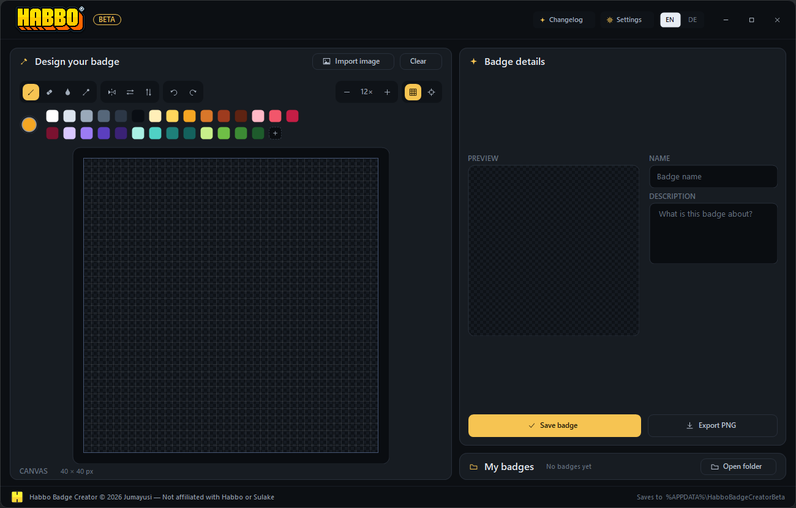
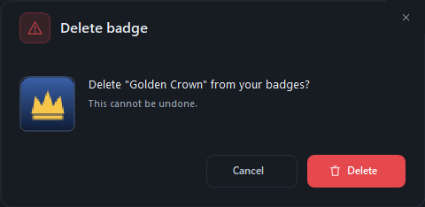

# Beta channel — Habbo Badge Creator Beta

This repository is the public beta channel for **Habbo Badge Creator**. The beta is a complete
standalone build: it has its own executable and its own data folder, so it can be installed next
to the stable app and tested without touching existing badges or settings.



## Which build should I use?

Use the **stable** build for everyday badge making. Use the **beta** if you want to try new tools
early, report problems, or help shape the next release. Beta features are marked in the app; they
are usable, but their behaviour and saved format may still change.

## What is different from the stable app

| | Stable app | Beta |
| --- | --- | --- |
| Executable | `Habbo Badge Creator.exe` | `Habbo Badge Creator Beta.exe` |
| Data folder | `%APPDATA%\HabboBadgeCreator` | `%APPDATA%\HabboBadgeCreatorBeta` |
| App bar | HABBO wordmark | HABBO wordmark + gold **BETA** pill |
| Splash | `BADGE CREATOR` | `BADGE CREATOR · BETA` |
| Version | `1.4.5` | `1.4.5-beta.28` |

Both builds can run at the same time. They never read or write each other's gallery, draft or
`settings.json`.

## What the beta adds

- **Layers** (`Ctrl+L`) — up to five layers with names, visibility, a 0–100 % opacity slider,
  per-layer lock and Normal / Multiply / Screen blending. Add, duplicate, merge down, move up or
  down, delete and flatten; every action is a single undo step. Double-click a layer name to
  rename it.
- **Rotate and copy** — turn the artwork 90° clockwise (`R`) or anticlockwise (`Shift+R`), and
  copy the finished 40 × 40 badge to the clipboard with `Ctrl+Shift+C` or the button beside
  **Export**.
- **Move layer (alpha)** — the **Move** tool (`V`) drags the active layer's pixels with the mouse
  in one undoable step, so a shape can be corrected without redrawing it. Alpha tools carry a
  constant red dot on their toolbar button and a red **ALPHA** chip in their tooltip.
- **Rectangle select (alpha)** — the **Rectangle select** tool (`S`) sweeps out a marquee. Drag
  inside it to carry those pixels elsewhere (the hole stays behind), `Delete` clears just the
  selected pixels, `Esc` or `Ctrl+D` deselects and `Ctrl+A` selects the whole canvas. While a
  selection exists the pencil, eraser and fill stay inside it. `Ctrl+C` copies the marquee,
  `Ctrl+X` cuts it, `Ctrl+V` pastes the copy beside it and `Ctrl+Shift+D` duplicates it in place,
  each one undoable; the copy is selected and ready to drag.
- **More export formats** — **Export** writes PNG, GIF, JPEG, ICO or SVG. JPEG is flattened onto
  white because the format has no transparency, ICO contains 16/32/48/64 px entries, and SVG is a
  40 × 40 vector built from one rect per horizontal colour run.
- **GIF export** — the **Export** button's save dialog lists PNG, GIF, JPEG, ICO and SVG;
  `Ctrl+Shift+G` opens it already switched to GIF. The badge is written as a real 40 × 40 GIF89a
  with a reserved transparent index, an exact palette up to 255 colours and median cut above that.
- **Performance mode** — Settings → Performance. The finished canvas is cached, a repaint copies
  the visible area instead of redrawing everything, and a stroke patches only the cells it
  crosses: measured about 0.5–1 ms per mouse move instead of 7–10 ms, for less input lag and lower CPU load.
- **Navy theme** — a third dark palette built from the same flat material tokens as Dark and
  Light, applied across the whole app.
- **Custom theme designer** — Settings → Appearance → **Custom**. Pick a surface, accent and text
  colour with the saturation/value square, hue rail, hex field or palette. Save named presets,
  recall them with one click, drag chips into a different order and double-click one to rename it.
- **Extra canvas tools** — centre / thirds / quarter guides (`C`), horizontal and vertical flip
  (`Shift+H` / `Shift+V`), and arrow-key nudging of the active layer.
- **Themed colour picker** - the round chip and the **+** button next to the palette open the
  app's own colour sheet: a saturation/value square with the hue rail, hex field, live R/G/B
  readout, before/after swatches and the palette, drawn in Dark, Light, Navy and Custom.
  Picking previews on the badge; **Cancel** puts the previous colour back.
- **Themed confirmations** - deleting a badge opens the app's own sheet with the badge preview and
  a danger **Delete** button, and import/export errors use the same sheet, in every palette.

### New in 1.4.5-beta.28

The alpha selection has a clipboard now. `Ctrl+C` copies the marquee, `Ctrl+X` cuts it, `Ctrl+V`
pastes the copy two pixels right and down, and `Ctrl+Shift+D` duplicates the selection in place.
Each is a single undo step, the copy stays fully inside the 40 × 40 canvas, and its marquee is
already selected, so it can be dragged straight into place with the Rectangle select tool.
Transparent pixels in the copy are skipped, so pasting never punches a hole in the artwork below.

While a selection exists, the line under the canvas lists the keys: drag to move, `Del`, `Ctrl+C`,
`Ctrl+Shift+D`. The selection itself is still not saved with the badge.

### New in 1.4.5-beta.27

The two alpha tools are marked in red — a constant red dot on the toolbar button and a red
**ALPHA** chip in the tooltip — so they are recognisable before they are picked, in every theme.

**Rectangle select** (`S`) works like Paint.NET's marquee: drag out a rectangle, then drag inside
it to move those pixels, leaving the transparent hole behind. `Delete` clears only the selected
pixels, `Esc` or a click without a drag deselects, `Ctrl+A` selects the whole 40 × 40 canvas and
`Ctrl+D` drops the selection. While a selection exists, the pencil, eraser and fill stay inside
it. Moving or deleting the selection is a single undo step, and the marquee is clamped to the
canvas.

Known limit of the alpha: the selection lives on the active layer only and is not saved with the
badge — saving, exporting and the autosaved draft store the flattened artwork as before.

### New in 1.4.5-beta.26

Drag a layer into place. The new **Move** tool in the toolbar (`V`) picks up the active layer and
lets it follow the mouse across the canvas, and the whole drag is a single undo step — a shape drawn
two pixels off no longer has to be erased and redrawn. Locked layers refuse to move exactly like
they refuse to paint, and the drag clips at the 40 × 40 edge.

**Export** now offers five file types instead of two. **PNG** keeps the transparent background,
**GIF** writes the app's own GIF89a, **JPEG** flattens the badge onto white because the format has
no transparency, **ICO** produces a Windows icon with 16, 32, 48 and 64 px entries and crisp
nearest-neighbour scaling, and **SVG** writes a real 40 × 40 vector made of one rect per horizontal
colour run. The typed extension picks the writer, so `badge.svg` entered through the PNG entry
still leaves an SVG behind.

### New in 1.4.5-beta.25

Badges can be exported as GIF. The **Export** button's save dialog lists **PNG image** and
**GIF image**; pick the GIF entry — or press `Ctrl+Shift+G`, which opens the same dialog already
switched to GIF — and the app writes the file itself, with no third-party encoder and nothing
extra to download.

The writer reserves palette index 0 for transparent pixels, keeps an exact palette while the badge
uses 255 colours or fewer, and switches to median-cut quantization above that, so a shaded badge
still comes out close. GIF stores only one fully transparent colour, so pixels below 50 % alpha
become transparent and the rest fully opaque: the badge's transparent background survives, soft
edges do not.

Nine new self-test checks cover the file signature and size, the decoded transparency and colours,
a 1,600-colour badge inside the palette tolerance, the bitmap entry point and the file-type
fallback. See the [full changelog](README.md#changelog).

### New in 1.4.5-beta.24

Checked at 125 % and 150 % display scaling. The window opens at 1625 × 972 and 1766 × 972 on a
1920 × 1080 display, and the two columns, canvas, palette, layer panel, badge list and footer all
follow the larger text without being cut off; Settings, Changelog, the colour sheet and the delete
sheet fit too. One clipping bug was found and fixed: the layer panel's blend chip drew its label
into a fixed 52 px slot, so the German label was cut mid-word at every scale. The label is measured
now and the mode name takes the rest, with the compact **MODUS** on the chip (the tooltip still
says *Füllmethode*, which needs 90 px of a 144 px chip).

Known limit: the sheets keep their fixed size, so on a display whose working area is shorter than
the sheet at 150 % — 768 px tall, for example — the Settings sheet would reach past the screen
edge. See the [full changelog](README.md#changelog).

### New in 1.4.5-beta.23

Badge deletion works again. Pressing **Delete** in the delete sheet closed the sheet but kept the
badge: the sheet's fade-out cancels the close Windows performs when a dialog result is set, and
Windows forgets the result on the way, so the sheet reported Cancel and nothing was deleted. The
fade now records the result the sheet is closing with and restores it before the real close, so
**Delete** deletes again and **Cancel**, Esc and the X still cancel. The other sheets never set a
dialog result and close as before. A new self-test check confirms a confirming sheet reports OK
to its caller (108 passed, 0 failed). See the [full changelog](README.md#changelog).

### New in 1.4.5-beta.22

The last stock Windows windows are gone. Deleting a badge used to open a pale system message box
with stock Yes/No buttons; it now opens the app's own delete sheet, with the badge on the
checkerboard, the name, "This cannot be undone" and a danger-coloured **Delete** button — drawn
from the active palette, so it matches Dark, Light, Navy and Custom. Import and export errors use
the same themed message sheet with a single **OK** button. Esc cancels, Enter confirms, the header
drags the sheet and it fades in and out like the other sheets. See the
[full changelog](README.md#changelog).



### New in 1.4.5-beta.21

Windows' colour dialog is gone. Colours are picked in the app's own sheet now — the same
saturation/value square and hue rail the custom theme designer uses, plus a hex field, a live
R/G/B readout, before/after swatches and the 28-colour palette, all drawn in the active palette
and previewing live on the badge behind the sheet. The square and the rail moved into one shared
painter, so the two pickers cannot drift apart. See the
[full changelog](README.md#changelog).

### New in 1.4.5-beta.20

The Settings and Changelog sheets fade in over the editor and fade back out when they close —
150 ms in, 120 ms out, eased at both ends. Closing while a sheet is still fading in continues
from the current opacity instead of flashing to full, and Windows' animation setting is
respected. See the [full changelog](README.md#changelog).

### New in 1.4.5-beta.19

No feature changes: this is the beta.18 app rebuilt and published by the release workflow from its
version tag, by the same run that compiles and self-tests it. See the
[full changelog](README.md#changelog).

### New in 1.4.5-beta.18

The Changelog sheet opens complete. Each entry is rendered on its own and the entries the sheet
opens on are ready before the window appears, so the blank body while opening is gone and the
first paint takes about 16 ms. See the [full changelog](README.md#changelog).

### New in 1.4.5-beta.17

Performance mode now paints from a cached canvas and patches only the stroke cells, so one
mouse move costs roughly a tenth of the painting it did before. Rich Presence can ship with the app's
own Discord application, so users no longer create one themselves. See the
[full changelog](README.md#changelog).

### New in 1.4.5-beta.16

The Changelog sheet lays its text out once and blits a cache, with eased wheel and track
scrolling. Performance mode now caches the grid and guides and repaints only the cells a
stroke crosses. See the [full changelog](README.md#changelog).

### New in 1.4.5-beta.15

The Changelog sheet's scrollbar behaves like a normal one: drag the handle, click the track to
page, or use the wheel. See the [full changelog](README.md#changelog).

### New in 1.4.5-beta.14

This is a release-polish build: proper Windows file details, public documentation, a license and
checksummed release packages. Drawing, layers, themes and presets are unchanged from beta.13.
See the [full changelog](README.md#changelog) or open **Changelog** in the app.

## Data and privacy

```
%APPDATA%\HabboBadgeCreatorBeta\
├─ badges\            saved badges: <id>.png (40×40) + <id>.json (name, description, date)
├─ draft.png          autosaved work in progress
├─ draft.json         draft name / description
└─ settings.json      language, theme, presets, performance mode and Discord Rich Presence
```

Nothing is uploaded. Badges, drafts and settings stay on the PC. The only outbound-ish connection
is the local Discord IPC pipe while Rich Presence is enabled; it talks to the Discord desktop
client, not to a web API.

To remove the beta completely, delete the executable and the folder above.

## Known beta limitations

- Layers are a working aid, not a stored format yet: saving, exporting and the autosaved draft
  store the flattened badge.
- GIF export writes a still image: GIF animation is not part of this build. GIF also stores only
  one transparent colour and at most 256 palette colours, so semi-transparent pixels become
  opaque or transparent and busy badges are quantized.
- JPEG export flattens the badge onto white — the format cannot store transparency. SVG export is
  pixel-accurate but built from one rect per colour run, not from redrawable paths.
- The Move tool and Rectangle select are alpha: they work on the active layer's pixels inside the
  40 × 40 canvas, clip whatever leaves it, and the selection itself is not saved with the badge.
- The custom theme designer and its presets are beta; the palette derivation and preset format
  may still change.
- The executable is not code-signed. Windows SmartScreen may ask you to confirm the first launch
  (**More info → Run anyway**).
- Discord Rich Presence uses a built-in application once the publisher adds one. Builds without
  it say so under Settings → Discord and accept a personal Application ID instead.
- Windows 10 version 1903 or newer / Windows 11 is required because the app uses .NET Framework
  4.8, which ships with both.

## Build from source

Only the C# compiler included with Windows is needed — no SDK, NuGet or toolchain install.

```bat
build.bat
dist\Habbo Badge Creator Beta.exe
```

From Git Bash or MSYS, run `./build.sh`. The output is always
`dist\Habbo Badge Creator Beta.exe`. See [README.md](README.md#rebuild-from-source) for the file
map and developer flags.

## Reporting a bug

Open an issue in this repository and include:

- your Windows version,
- the app version from the **BETA** pill tooltip,
- the steps that led to the problem and what you expected instead,
- a screenshot if it is visual.

Please do not attach personal badges or your Discord Application ID.

## License and trademarks

Copyright © 2026 Jumayusi. All rights reserved. See [LICENSE](LICENSE).

Habbo Badge Creator is a fan-made tool and is not affiliated with, endorsed by or sponsored by
Habbo or Sulake. HABBO and the Habbo logo are trademarks of Sulake Corporation Oy.
