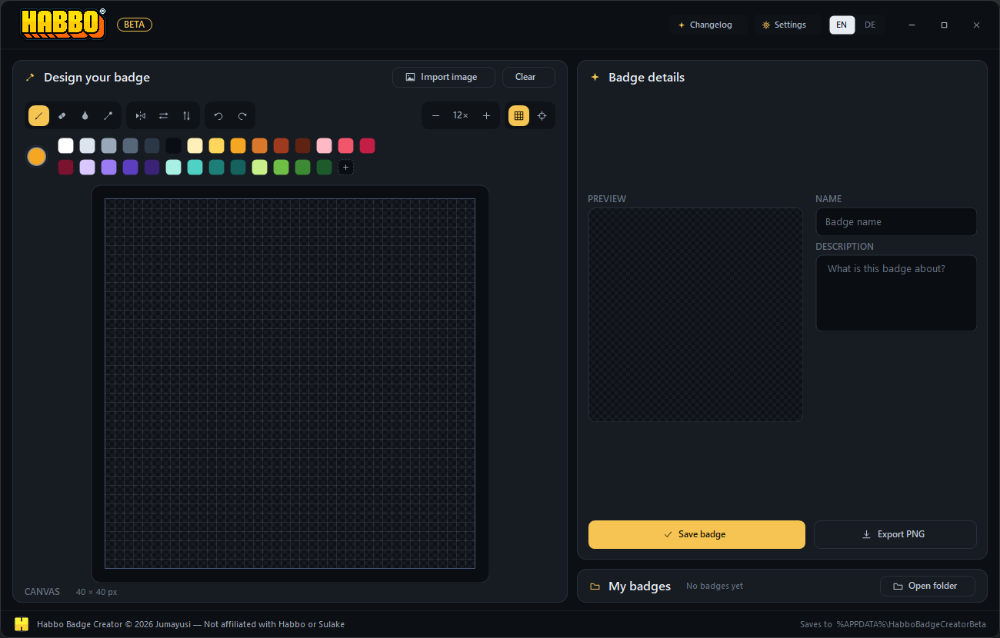

# Beta channel — Habbo Badge Creator Beta

This repository is the public beta channel for **Habbo Badge Creator**. The beta is a complete
standalone build: it has its own executable and its own data folder, so it can be installed next
to the stable app and tested without touching existing badges or settings.



## Which build should I use?

Use the **stable** build for everyday badge making. Use the **beta** if you want to try new tools
early, report problems, or help shape the next release. Beta features are marked in the app; they
are usable, but their behaviour and saved format may still change.

## What is different from the stable app

| | Stable app | Beta |
| --- | --- | --- |
| Executable | `Habbo Badge Creator.exe` | `Habbo Badge Creator Beta.exe` |
| Data folder | `%APPDATA%\HabboBadgeCreator` | `%APPDATA%\HabboBadgeCreatorBeta` |
| App bar | HABBO wordmark | HABBO wordmark + gold **BETA** pill |
| Splash | `BADGE CREATOR` | `BADGE CREATOR · BETA` |
| Version | `1.4.5` | `1.4.5-beta.14` |

Both builds can run at the same time. They never read or write each other's gallery, draft or
`settings.json`.

## What the beta adds

- **Layers** (`Ctrl+L`) — up to five layers with names, visibility, a 0–100 % opacity slider,
  per-layer lock and Normal / Multiply / Screen blending. Add, duplicate, merge down, move up or
  down, delete and flatten; every action is a single undo step. Double-click a layer name to
  rename it.
- **Rotate and copy** — turn the artwork 90° clockwise (`R`) or anticlockwise (`Shift+R`), and
  copy the finished 40 × 40 badge to the clipboard with `Ctrl+Shift+C` or the button beside
  **Export PNG**.
- **Performance mode** — Settings → Performance. While a stroke is running, only the touched
  cells repaint, the grid and checkerboard come from a cache and the large preview is batched,
  for less input lag and lower CPU load.
- **Navy theme** — a third dark palette built from the same flat material tokens as Dark and
  Light, applied across the whole app.
- **Custom theme designer** — Settings → Appearance → **Custom**. Pick a surface, accent and text
  colour with the saturation/value square, hue rail, hex field or palette. Save named presets,
  recall them with one click, drag chips into a different order and double-click one to rename it.
- **Extra canvas tools** — centre / thirds / quarter guides (`C`), horizontal and vertical flip
  (`Shift+H` / `Shift+V`), and arrow-key nudging of the active layer.

### New in 1.4.5-beta.14

This is a release-polish build: proper Windows file details, public documentation, a license and
checksummed release packages. Drawing, layers, themes and presets are unchanged from beta.13.
See the [full changelog](README.md#changelog) or open **Changelog** in the app.

## Data and privacy

```
%APPDATA%\HabboBadgeCreatorBeta\
├─ badges\            saved badges: <id>.png (40×40) + <id>.json (name, description, date)
├─ draft.png          autosaved work in progress
├─ draft.json         draft name / description
└─ settings.json      language, theme, presets, performance mode and Discord Rich Presence
```

Nothing is uploaded. Badges, drafts and settings stay on the PC. The only outbound-ish connection
is the local Discord IPC pipe while Rich Presence is enabled; it talks to the Discord desktop
client, not to a web API.

To remove the beta completely, delete the executable and the folder above.

## Known beta limitations

- Layers are a working aid, not a stored format yet: saving, exporting and the autosaved draft
  store the flattened badge.
- The custom theme designer and its presets are beta; the palette derivation and preset format
  may still change.
- The executable is not code-signed. Windows SmartScreen may ask you to confirm the first launch
  (**More info → Run anyway**).
- Discord Rich Presence needs your own Discord Application ID. The app explains the one-time
  setup under Settings → Discord.
- Windows 10 version 1903 or newer / Windows 11 is required because the app uses .NET Framework
  4.8, which ships with both.

## Build from source

Only the C# compiler included with Windows is needed — no SDK, NuGet or toolchain install.

```bat
build.bat
dist\Habbo Badge Creator Beta.exe
```

From Git Bash or MSYS, run `./build.sh`. The output is always
`dist\Habbo Badge Creator Beta.exe`. See [README.md](README.md#rebuild-from-source) for the file
map and developer flags.

## Reporting a bug

Open an issue in this repository and include:

- your Windows version,
- the app version from the **BETA** pill tooltip,
- the steps that led to the problem and what you expected instead,
- a screenshot if it is visual.

Please do not attach personal badges or your Discord Application ID.

## License and trademarks

Copyright © 2026 Jumayusi. All rights reserved. See [LICENSE](LICENSE).

Habbo Badge Creator is a fan-made tool and is not affiliated with, endorsed by or sponsored by
Habbo or Sulake. HABBO and the Habbo logo are trademarks of Sulake Corporation Oy.
