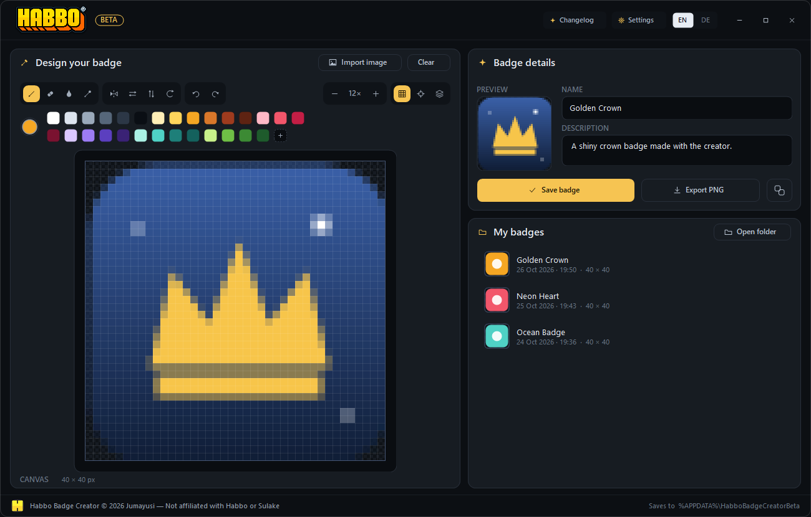
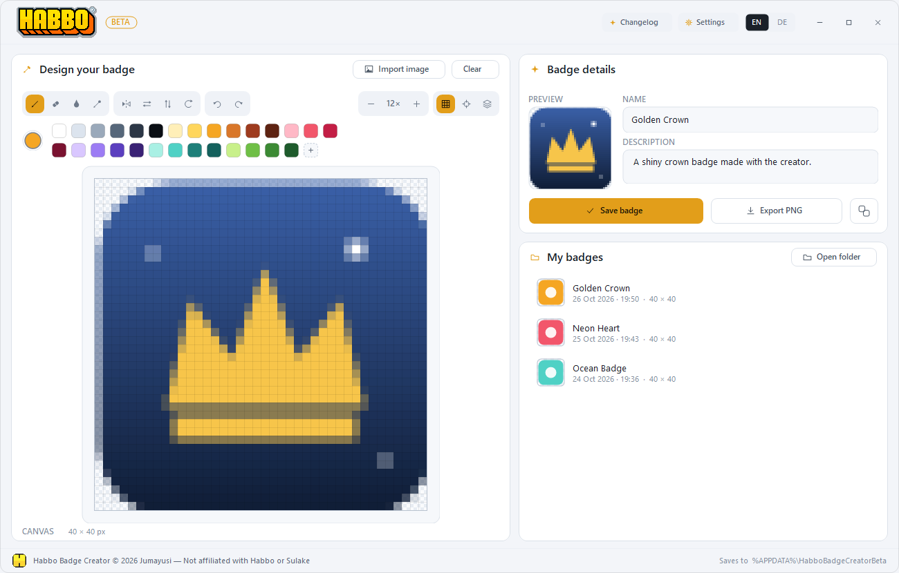
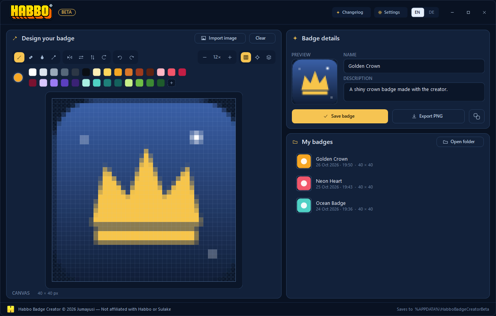
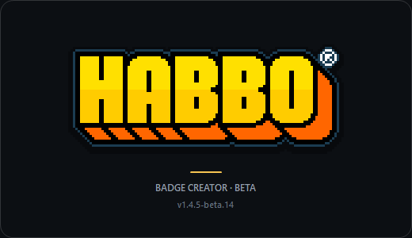
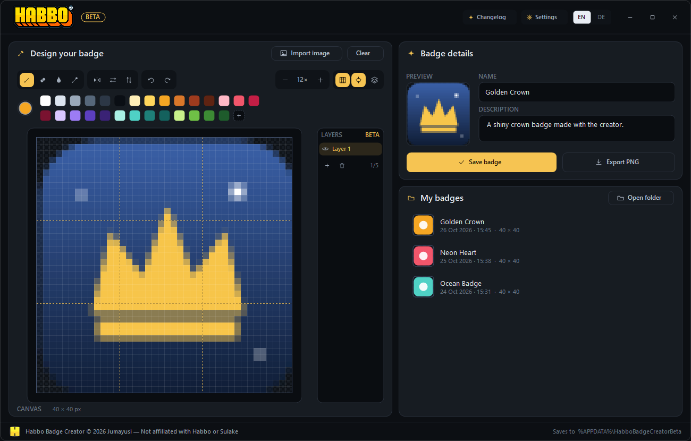
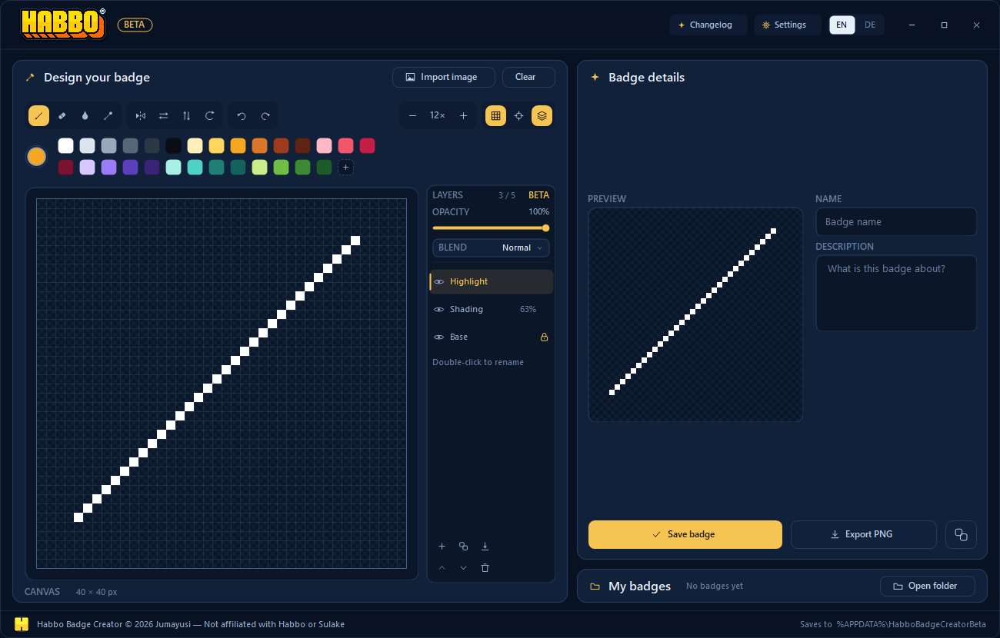
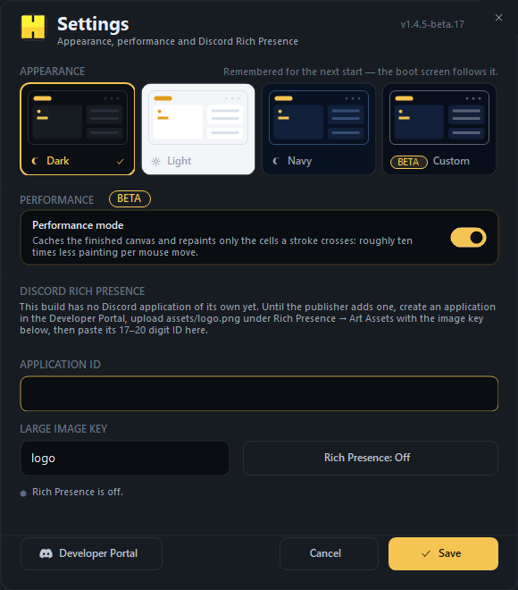
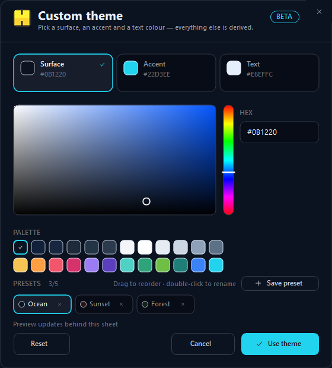
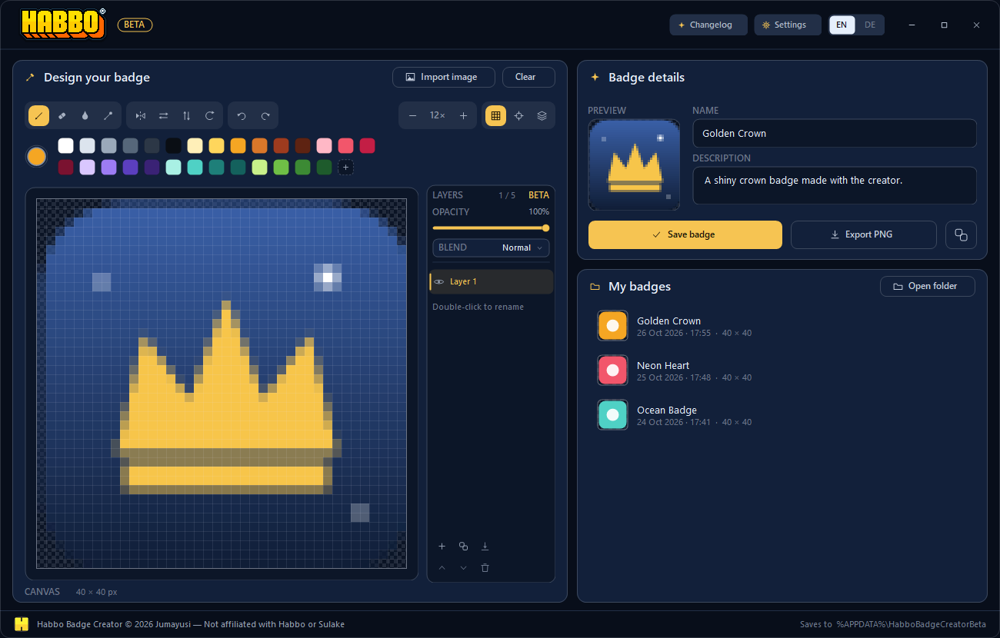
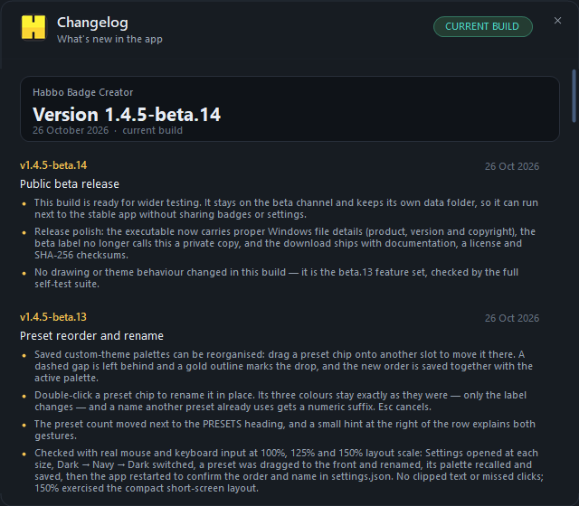

# Habbo Badge Creator — Beta

**A portable 40 × 40 badge editor for Habbo Hotel.** One `.exe`, no installer, no telemetry.
This is the public beta channel: it ships its own executable and data folder, so it can run
next to the stable app without sharing badges or settings.

**[Download the latest beta →](../../releases/latest)** · [Beta notes](BETA.md) · [What's new](#changelog)

A compact, flat material interface in dark, light and navy themes — plus a beta custom-theme
designer — in a single `.exe` with no installer.







Deutsche Oberfläche: [docs/preview-de.png](docs/preview-de.png)



## Requirements and install

- **Windows 10 (1903 or newer) or Windows 11.** The app is a native .NET Framework 4.8
  WinForms build; 4.8 is part of both Windows versions, so there is nothing to download.
- **No installer, no admin rights.** Extract the release ZIP and run
  `Habbo Badge Creator Beta.exe` from any folder, USB stick or another PC.
- **Windows SmartScreen:** the build is not code-signed, so Windows may show
  “Windows protected your PC”. Choose **More info → Run anyway**.
- **Verify the download:** use the `SHA256SUMS.txt` from the same release:
  `certutil -hashfile "Habbo Badge Creator Beta <version>.zip" SHA256`.
- **Uninstall:** delete the `.exe`. Delete `%APPDATA%\HabboBadgeCreatorBeta` to remove saved
  badges, the draft and settings as well.

The app is roughly 600 KB on disk and starts instantly. There is no telemetry and no
background service; it only talks to the local Discord desktop client when Rich Presence is on.

## What you can do

- **Draw** in a real 40 × 40 pixel canvas with pencil, eraser, flood fill and colour picker
- **Tooltips** on every drawing tool show its name and keyboard shortcut on hover
- **Mirror drawing** (classic symmetric badges), pixel grid, zoom 3×–24×
- **Guides** cycle through centre, rule of thirds and quarters (`C`)
- **Flip the canvas** left/right or top/bottom in one undoable step (`Shift+H` / `Shift+V`)
- **Beta: layers** — up to 5 layers, each with its own name, visibility, **opacity slider**, **lock** and **blend mode** (Normal, Multiply, Screen), plus add, duplicate, merge down, move up/down, delete and flatten (`Ctrl+L`); double-click a layer to rename it inline
- **Arrow keys** nudge the active layer by 1 px, `Shift`+arrow by 5 px
- **Beta: rotate** the whole badge 90° clockwise (`R`) or anticlockwise (`Shift`+`R`)
- **Beta: copy to clipboard** — send the finished 40 × 40 badge straight into Discord, Paint or any other app with the button next to Export PNG (`Ctrl`+`Shift`+`C`)
- **Beta: Performance mode** in Settings — the finished canvas is cached, a repaint copies just the  visible area and a stroke patches only the cells it crosses: roughly a tenth of the painting per mouse move, lower CPU load and less input lag
- **28 colour palette** plus a full custom colour picker
- **Undo / redo** (80 steps), right-click always erases
- **Import** PNG / GIF / JPG / BMP (button or drag the file onto the window) — auto-scaled to 40 × 40
- **Export PNG** at exactly 40 × 40 with a transparent background
- **My badges library** — every saved badge is listed with its preview; click to load it again. While the library is empty it collapses to a slim bar, giving the badge details card the extra room
- **Autosave** — your work in progress is restored the next time you open the app
- **Live painting** — the canvas and preview follow the cursor pixel by pixel while you drag
- **Adaptive window** — rounded, borderless, with a flat app bar; the layout compacts itself on short screens (e.g. 150% scaling on 1080p)
- **English / German** — one click on the `EN | DE` switch in the header, remembered for next launch
- **Discord Rich Presence** — shows the app and your badge-in-progress on your Discord profile. A release carries its own Discord application, so there is nothing to set up; a personal Application ID can still be entered in Settings
- **Boot splash** — the HABBO wordmark fades in and out while the app starts (click or press a key to skip)
- **Changelog** — the `Changelog` chip in the header opens the versioned release notes of every update, in the current language
- **Dark / light / navy / custom theme** — the `Settings` chip opens Settings, where a visual picker switches the whole app (and the splash) between the dark, light and **Navy** palettes, plus a **beta Custom** designer: pick a surface, an accent and a text colour, save named presets, recall them with one click, drag them into a different order and double-click to rename one; the choice is remembered





## Themes & settings

Click the **Settings** chip in the header. It opens with an **Appearance** section: four
preview tiles show the dark, light, **Navy** and **Custom** palettes, and clicking one repaints
the whole app immediately (and previews the result in the editor behind the sheet) — the
splash screen follows the saved theme on the next start. **Save** stores
the choice in `settings.json`; **Cancel** or `Esc` reverts the preview. Below it sits a
**Performance** section with the beta **Performance mode** switch — it keeps drawing cheap
on slower machines and is remembered per install. The same sheet holds the Discord Rich
Presence settings and shows the current connection state.



### Custom theme (beta)

The fourth tile opens the colour designer: pick **Surface** (cards and sheets), **Accent**
(buttons, selection and links) and **Text**, using the saturation/value square, the hue rail,
a hex value or the 24-colour palette. Page, recesses, lines, muted text and the checkerboard
are derived from those three, and a bright surface flips the palette to its light-family
derivations. Everything previews live behind the sheet; **Use theme** applies it and the
three colours plus `theme: custom` are stored in `settings.json`.

Below the palette sits **Presets**: **Save preset** asks for a name (Enter saves, Esc cancels),
and every saved palette appears as a chip with its own colour dot. Click a chip to recall its
surface, accent and text instantly, click the small × to delete it, or save under an existing
name to overwrite it — up to five presets. To tidy the row, drag a chip onto another slot (a
dashed gap is left behind and a gold outline marks the drop) or double-click a chip to rename
it in place; renaming keeps its colours, and a name another preset uses gets a numeric suffix.
The list and the active palette live together in `settings.json` and are restored on the next
start.





## Changelog

Press the **Changelog** chip next to the Settings chip. The sheet shows the running version
and a dated entry per release, so a new build ships its own notes. Entries live in
`AppInfo.Releases` in [src/Changelog.cs](src/Changelog.cs) — add one when you bump
`AppInfo.Version`.



| Version | Date | Highlights |
| --- | --- | --- |
| 1.4.5-beta.18 | 27 Oct 2026 | **Beta:** the Changelog sheet opens fully painted — entries render on demand and the opening screen is ready before the window appears (first paint about 16 ms instead of ~1 s) |
| 1.4.5-beta.17 | 26 Oct 2026 | **Beta:** Performance mode paints from a cached canvas and patches only the stroke cells (roughly 10× less work per move); Rich Presence ships with the app's own Discord application |
| 1.4.5-beta.16 | 26 Oct 2026 | **Beta:** cached, eased changelog scrolling; Performance mode repaints only the stroke cells |
| 1.4.5-beta.15 | 26 Oct 2026 | **Beta:** changelog scrollbar can be dragged, clicked and wheeled |
| 1.4.5-beta.14 | 26 Oct 2026 | **Beta:** public release polish — Windows file details, release package, docs; no feature changes |
| 1.4.5-beta.13 | 26 Oct 2026 | **Beta:** drag presets to reorder, double-click to rename; 125% and 150% layouts driven for real |
| 1.4.5-beta.12 | 26 Oct 2026 | **Beta:** named custom-theme presets; designer chrome follows the live palette |
| 1.4.5-beta.11 | 26 Oct 2026 | **Beta:** custom theme designer; canvas now repaints when switching between dark palettes |
| 1.4.5-beta.10 | 26 Oct 2026 | **Beta:** layer panel overhaul (names, opacity, lock, blend), rotate, copy to clipboard |
| 1.4.5-beta.9 | 26 Oct 2026 | **Beta:** Navy theme replaces Glass, applied across the whole app |
| 1.4.5-beta.8 | 26 Oct 2026 | **Beta:** cleaner, glassier Glass theme — lit panes, reflections, smoked recesses |
| 1.4.5-beta.7 | 26 Oct 2026 | **Beta:** performance switch drawn with its row, click anywhere on the row |
| 1.4.5-beta.6 | 26 Oct 2026 | **Beta:** dark glassmorphism theme in the appearance picker |
| 1.4.5-beta.5 | 26 Oct 2026 | **Beta:** layer duplicate/merge/move tools, performance mode switch |
| 1.4.5-beta.4 | 26 Oct 2026 | **Beta:** layers panel, guide thirds/quarters, arrow-key nudge, version+build on hover |
| 1.4.5-beta.3 | 26 Oct 2026 | **Beta:** no stale card borders when My badges collapses or expands |
| 1.4.5-beta.2 | 26 Oct 2026 | **Beta:** flip the whole canvas horizontally / vertically |
| 1.4.5 | 26 Oct 2026 | Centre guides toggle next to the pixel grid (`C`) |
| 1.4.4 | 26 Oct 2026 | Developer Portal button jumps straight to the app's Rich Presence → Art Assets page |
| 1.4.3 | 26 Oct 2026 | Discord mark on the Developer Portal button in Settings |
| 1.4.2 | 26 Oct 2026 | Crisp changelog text in the light theme, notes scroll in a real viewport |
| 1.4.1 | 26 Oct 2026 | One `Settings` chip in the app bar (Discord chip merged into it) |
| 1.4.0 | 26 Oct 2026 | Light theme with an appearance picker, settings chip in the app bar |
| 1.3.0 | 26 Oct 2026 | Boot splash, in-app changelog, new footer credit |
| 1.2.0 | 26 Oct 2026 | Tooltips with shortcuts, roomier app bar, collapsing badge library |
| 1.1.0 | 26 Oct 2026 | Compact flat material redesign, rounded borderless window |
| 1.0.0 | 26 Oct 2026 | First release: editor, PNG export, badge library, EN/DE, Discord RPC |

## Discord Rich Presence

Discord only accepts presence from a registered *application*. A release therefore carries
one built into the app: in those builds Rich Presence is on by default, uses the app's own
Discord application and needs no setup from you. Keep the Discord desktop client running and
your profile shows **Habbo Badge Creator** with the badge name you are working on.

Want your own application name and artwork instead? Enter a personal **Application ID**
under *Settings → Discord Rich Presence*; it takes precedence over the built-in one.

A build that does not carry an application yet says so in Settings instead of pretending:
until the publisher adds one, paste your own ID there.

The app keeps the presence updated while it runs and reconnects on its own when Discord
starts later. The dot on the **Settings** chip reports the state at a glance — teal
connected, gold waiting for Discord, red refused — and the dot only appears while Rich
Presence is configured. Hovering the chip spells that state out in words (`Connected`,
`Connecting…`, `Discord is not running`, `Connection refused`, `Off`).
Everything stays local: it talks to the Discord desktop client over
`\\.\pipe\discord-ipc-0…9`, no bot token, no network calls.

### Publisher: adding the built-in application (once)

1. Open <https://discord.com/developers/applications> → **New Application** and name it
   `Habbo Badge Creator` (that name is what profiles show).
2. **Rich Presence → Art Assets** → upload `assets/discord/rich-presence-1024.png`
   (1024 × 1024) and set its image key to `logo`. New assets can take a few minutes to appear.
3. Copy the **Application ID** from *General Information* and paste it into
   `DiscordRpc.BuiltInAppId` in [src/Discord.cs](src/Discord.cs), then rebuild once
   (`build.bat`).

From that build on, every user gets Rich Presence without creating anything. The ID is
public by nature (it is what Discord uses to attach the app's name and artwork); no secret,
bot token or OAuth data is involved. In the app, the **Developer Portal** button in Settings
opens the Art Assets page of whichever application is in use — the built-in one when the
field is empty.


## Keyboard shortcuts

| Key | Action |
| --- | --- |
| `B` / `E` / `G` / `I` | Pencil / Eraser / Fill / Colour picker |
| `M` | Toggle mirror drawing |
| `C` | Cycle guides: centre → thirds → quarters → off |
| `Shift` + `H` / `V` | Flip the canvas horizontally / vertically |
| `R` / `Shift` + `R` | Rotate the badge 90° clockwise / anticlockwise (beta) |
| `Arrow keys` | Nudge the active layer by 1 px (`Shift` = 5 px) |
| `Ctrl` + `L` | Toggle layers (beta) |
| `Ctrl` + `Shift` + `C` | Copy the badge to the clipboard (beta) |
| `Ctrl` + `J` | Duplicate the active layer |
| `Ctrl` + `M` | Merge the active layer into the one below |
| `Alt` + `↑` / `↓` | Move the active layer up / down the stack |
| `Ctrl` + `Z` / `Y` | Undo / Redo |
| `Ctrl` + `S` | Save badge to the library |
| `Ctrl` + `E` | Export PNG |
| `Ctrl` + `O` | Import image |
| `Ctrl` + `+` / `-` | Zoom in / out |
| `0` | Fit canvas |
| `Right mouse button` | Erase |
| `Mouse wheel` | Zoom |

## Where files are stored

```
%APPDATA%\HabboBadgeCreatorBeta\
├─ badges\            saved badges: <id>.png (40×40) + <id>.json (name, description, date)
├─ draft.png          autosaved work in progress
├─ draft.json         draft name / description
└─ settings.json      language, theme, presets, performance mode and Discord Rich Presence
```

The **Open folder** button next to *My badges* opens that folder. The stable app keeps its
files in `%APPDATA%\HabboBadgeCreator`, so the beta and the stable build can run side by side
without reading each other's badges or settings.

Nothing is uploaded: badges, drafts and settings stay in that folder. The only outbound-ish
connection is the local Discord IPC pipe while Rich Presence is enabled; exports only go where
you save them.

## Reporting bugs

Open an issue in this repository. Include your Windows version, the app version from the
**BETA** pill tooltip, what you did and what happened. Screenshots help. Please do not attach
personal badges or your Discord Application ID.

## Rebuild from source

Only the C# compiler that ships with Windows is used — no SDK, no NuGet, no toolchain install.

```
build.bat
```

or, from Git Bash / MSYS:

```
./build.sh
```

That compiles `src\*.cs` into `dist\Habbo Badge Creator Beta.exe` with the app manifest
(DPI aware + visual styles), embeds the logo for in-app drawing and applies the window /
`.exe` icon from `assets\habbo.ico`.

`assets\habbo.ico` is generated from `assets\logo.png` (16, 20, 24, 32, 40, 48, 64, 128 and
256 px frames) by `tools/MakeIcon.cs`. To change the logo, replace `assets/logo.png`, then:

```
csc /out:MakeIcon.exe /r:System.Drawing.dll tools\MakeIcon.cs
MakeIcon.exe assets\logo.png assets\habbo.ico
build.bat
```

| Path | Purpose |
| --- | --- |
| `src/Theme.cs` | dark, light, navy and custom palettes, fonts, GDI+ helpers, vector icon set |
| `src/PixelDoc.cs` | 40 × 40 pixel document, layers, presets, undo history, PNG scaling, badge storage |
| `src/Controls.cs` | custom drawn buttons, inputs, canvas, preview, badge list |
| `src/MainForm.cs` | window layout, tools, shortcuts, window chrome |
| `src/SettingsForm.cs` | settings sheet: appearance, performance and Discord Rich Presence |
| `src/ThemeDesigner.cs` | beta custom-theme designer with named, reorderable presets |
| `src/Discord.cs` | Discord IPC client (handshake, activity frames, reconnect) and the built-in application ID |
| `src/Lang.cs` | English / German string lookup |
| `src/Splash.cs` | startup splash with the fading HABBO wordmark |
| `src/Changelog.cs` | app version, footer credit and the release-notes sheet |
| `src/Program.cs` | entry point, DPI setup, `--selftest` / `--shot` developer modes |
| `src/AssemblyInfo.cs` | Windows file details: product, version and copyright |
| `tools/MakeIcon.cs` | builds the multi-size `.ico` from the logo PNG |
| `assets/logo.png` | app icon, footer mark and settings-sheet tile |
| `assets/habbo-wordmark.png` | HABBO logo shown in the header |
| `assets/habbo.ico` | generated icon used for `Habbo Badge Creator Beta.exe` |
| `assets/discord/rich-presence-1024.png` | Rich Presence art asset to upload once (`logo`) for the built-in Discord application |

### Developer flags

```
"dist\Habbo Badge Creator Beta.exe" --selftest log.txt           # headless checks of pixels + storage
"dist\Habbo Badge Creator Beta.exe" --shot ui.png --demo         # render the window to a PNG
"dist\Habbo Badge Creator Beta.exe" --shot ui.png --demo --stroke  # render mid-stroke (live repaint check)
"dist\Habbo Badge Creator Beta.exe" --shot ui-de.png --lang de      # render the German UI
"dist\Habbo Badge Creator Beta.exe" --shot-splash splash.png       # render the boot splash
"dist\Habbo Badge Creator Beta.exe" --tip                          # show a tooltip (live run)
"dist\Habbo Badge Creator Beta.exe" --shot tip.png --tip           # tooltip in a rendered PNG
"dist\Habbo Badge Creator Beta.exe" --shot chip.png --tip chip     # Settings chip tooltip in a PNG
"dist\Habbo Badge Creator Beta.exe" --changelog                    # open the changelog (live run)
"dist\Habbo Badge Creator Beta.exe" --settings                     # open the settings sheet (live run)
"dist\Habbo Badge Creator Beta.exe" --shot light.png --theme light # render in the light theme
"dist\Habbo Badge Creator Beta.exe" --shot-settings sheet.png       # render the settings sheet
"dist\Habbo Badge Creator Beta.exe" --shot-changelog notes.png      # render the release notes
"dist\Habbo Badge Creator Beta.exe" --scale 1.5 --nosplash          # render at 150% layout scale
"dist\Habbo Badge Creator Beta.exe" --nosplash                     # skip the startup splash
```

`--selftest` covers the pixel document (set, line, mirror, flood fill, undo/redo, PNG
import scaling), the badge library (save, list, metadata round trip, delete, draft),
the settings round trip and the Discord IPC handshake/activity frames against a local
pipe. It never touches your saved badges.

## License

Copyright © 2026 Jumayusi. All rights reserved. The compiled beta may be downloaded and used
free of charge; the source is published for transparency. See [LICENSE](LICENSE) for the full
terms.

Habbo Badge Creator is a fan-made tool and is not affiliated with, endorsed by or sponsored by
Habbo or Sulake. HABBO and the Habbo logo are trademarks of Sulake Corporation Oy. Badge sizes
and the PNG format match what Habbo's own badge creator accepts.

---

Habbo Badge Creator © 2026 Jumayusi — Not affiliated with Habbo or Sulake.
